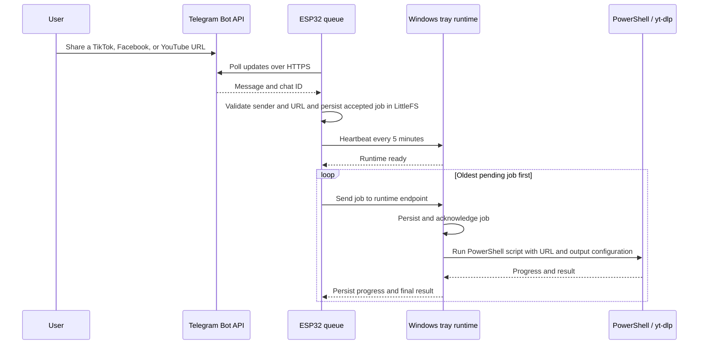

# ESP32 Local Download Controller

Headless controller for the CYD-3248S035R with an ESP32-WROOM-32, 4 MB flash, and no SD card. TFT/LVGL and touch are out of scope; the ESP32 stores the shared settings database, jobs, and device network settings, while Windows runs `yt-dlp` and stores downloaded files.

## Project structure

```text
Esp32-Download/
├── firmware-cyd/                          # ESP32 Firmware (PlatformIO)
│   ├── platformio.ini                     # Six 4MB targets (ESP32-WROOM-32, S2, S3, C3, C5, C6)
│   ├── partitions.csv                     # Partition table (3.75MB app0 + 192KB LittleFS)
│   ├── build_firmware.ps1                 # Build/release all six targets and export standalone source packages
│   ├── src/
│   │   ├── main.cpp                       # ESP32 APIs, Telegram polling, LittleFS queue, cyber-dark setup UI
│   │   └── telegram_root_ca.h             # Root CA certificates for Telegram HTTPS API
│   └── releases/<model>/                  # Per-model app image and independent `source/` PlatformIO project
├── local-host/                            # Windows Host & Dashboard Service
│   ├── server.mjs                         # Node.js backend: REST APIs, scheduled queue runner, session auth
│   ├── Invoke-YtDlp.ps1                   # Core download worker: yt-dlp video remux & gallery-dl photo albums (UTF-8 pipeline, --playlist-end cho link profile)
│   ├── Run-TrayRuntime.ps1                # Background tray icon runtime and task loop
│   ├── Install-TrayRuntime.ps1            # Windows service/task scheduler & firewall setup
│   ├── data/                              # Local runtime secrets and queues (git-ignored)
│   │   ├── local-config.json              # Dashboard settings, tokens, paths, schedules
│   │   ├── runtime-queue.json             # Pending jobs dispatched to Windows worker
│   │   └── scheduled-downloads.json       # Lịch tải định kỳ (daily/weekly/monthly)
│   └── public/                            # Web Dashboard (Accessible at http://127.0.0.1:8787)
│       ├── index.html                     # Responsive UI: Hero pipeline, monitor, queue, schedules, logs
│       ├── styles.css                     # Cyber-dark design system, responsive grids, controls
│       ├── app.js                         # Dynamic state management, smooth cubic Beziers, scheduling APIs
│       └── (APK files served dynamically by server.mjs from mobile/android build outputs)
├── mobile/android/                        # Native Android Companion App
│   ├── build.gradle                       # Android Gradle Plugin and Kotlin plugin versions
│   ├── settings.gradle                    # App module and dependency repositories
│   ├── gradle.properties                  # Gradle/AndroidX build properties
│   ├── build_apk.ps1                      # Build standard and clean-test APK flavors
│   ├── PROJECT_STRUCTURE.md               # Detailed Android module/source tree
│   └── app/
│       ├── build.gradle                   # SDK, Java/Kotlin, flavors, dependencies, native build
│       └── src/main/                      # Manifest, Java, native C/C++, resources and flasher
├── docs/                                  # Project documentation & legacy notes
└── tools/                                 # Flash and hardware testing utilities
    ├── cyd-flash-preflight/               # Dò chip/flash ESP32 (probe_flash_rom.py, cyd_16mb.csv)
    └── cyd-display-preflight/             # Thử màn hình/LVGL của CYD (ngoài phạm vi firmware chính)
```

Backup trước mỗi đợt sửa lớn nằm ngoài dự án tại `D:\Source_Tools\_backup\` (script `D:\Source_Tools\Backup-Esp32-Download.ps1`, thêm `-FlashBackup` để lưu cả 4 MB flash của ESP32 trên COM3).

### Truy cập giao diện

| Địa chỉ | Hiển thị |
|---|---|
| `http://127.0.0.1:8787` (trên PC) | Dashboard đầy đủ, tự co giãn theo máy tính/điện thoại, có chế độ sáng/tối |
| `http://192.168.1.2:8787` (PC trong LAN) | Cùng dashboard, đăng nhập bằng tài khoản host |
| `http://192.168.1.5/` (ESP32 trong LAN) | Tự chuyển hướng sang dashboard của PC khi Windows runtime đang online, nên giao diện và chức năng giống hệt. Nếu PC tắt thì hiện trang cài đặt của ESP32 |
| `http://192.168.1.5/?setup=1` hoặc `/setup` | Luôn mở trang cài đặt Wi‑Fi/Telegram của ESP32, không chuyển hướng |
| `http://192.168.4.1/` (SoftAP) | Trang cài đặt ESP32 (PC không tới được từ SoftAP nên không chuyển hướng) |

The browser dashboard, Android app, and ESP32 share the persistent device settings and queue through the authenticated device API. The Android theme is saved on the phone; the browser theme is saved in that browser. The ESP32 setup web interface provides direct provisioning and status monitoring over both SoftAP (`http://192.168.4.1/`) and home LAN (`http://<esp-ip>/`).

## System backup and hardware firmware

In the local-host web dashboard or Android app, open **Bảo mật** to back up or restore host and ESP32 configuration. Both create the same unencrypted JSON schema in a `.espbackup` file, so a backup from either app can be restored by the other. Files contain credentials and Wi-Fi settings; store them securely and only restore files you trust. Restore validates the backup and checks the ESP32's hardware-specific GPIO settings before applying them; the device restarts after a successful restore.

Build all supported firmware variants from `firmware-cyd` with:

```powershell
.\build_firmware.ps1
```

The script creates a regular app image for each target under `firmware-cyd\releases\<model>\<model>-firmware.bin`, with an independent, directly buildable PlatformIO project in each model's `source` folder. Each `source\platformio.ini` has its own default environment, board, target-specific flags and shared build settings; the WROOM-32 package also preserves COM3 as its upload/monitor port. To refresh only the source packages from the current firmware source without rebuilding the images, run `.\build_firmware.ps1 -SkipBuild`. These are application images, not full-flash images; flash them at `0x10000`.

The Android build script also creates `esp-download-clean-test.apk` (`com.espdownload.mobile.fresh`), a side-by-side test install with no saved app preferences and a blank host field. The regular app remains installed separately. See [mobile/android/PROJECT_STRUCTURE.md](./mobile/android/PROJECT_STRUCTURE.md) for the Android source and build structure.

## Intended flow



- The ESP32 polls Telegram itself, so a powered-off Windows PC does not prevent the bot from receiving a URL. The board must remain powered and connected to Wi-Fi with Internet access.
- Only messages from configured Telegram chat IDs are eligible. Video links must belong to TikTok, Facebook, or YouTube. When image downloads are enabled, direct HTTP/HTTPS image links from other hosts and TikTok `/photo/` posts are also accepted. Messages without a URL are ignored; malformed, unsupported, duplicate, unauthorized, overlong, and queue-full URL attempts are rejected. The ESP32 keeps the latest 64 URL decisions in its LittleFS Telegram log.
- Accepted jobs stay `QUEUED` on the ESP32 while Windows is offline. Every five minutes the ESP32 checks the configured Windows runtime URL. Once the runtime replies ready, the ESP32 sends jobs in queue order. If a delivery response is lost, the job ID makes the host acknowledgement idempotent.
- The Windows runtime writes received jobs to `local-host/data/runtime-queue.json` before acknowledging them. It runs one job at a time, in FIFO order, through `Invoke-YtDlp.ps1`; progress and final results are reported back to the ESP32 and saved in `runtime-history.json`.
- The dashboard provides separate queued, completed, and failed URL lists; Telegram inbox entries have copy, force-download, restart, and delete actions. Each Telegram URL carries its Telegram `update_id`, and its inbox row follows the linked job state (queued, downloading, completed, failed, or cancelled). The ESP32 persists a bounded ledger of the latest 512 canonical URL fingerprints as well as Telegram event IDs. It backfills that ledger from older jobs and logs on boot, so deleting either a log or job does not make a replayed URL eligible for a second Telegram job. Explicit host Restart/Force actions remain available for intentional retries. URL actions and current job state are shared with Android.
- Download settings include Auto/MP4/FLV/AVI/MKV/TS/WebM remux selection and an opt-in image-download setting. Direct image URLs use Windows PowerShell; TikTok photo posts use `gallery-dl`, followed by a separate MP3 attempt for the post audio. Both interfaces provide a persistent light/dark theme.
- The host dashboard is available at `http://127.0.0.1:8787` on Windows. The runtime listener binds to the PC's LAN interfaces for authenticated ESP32 heartbeat/job delivery. The listener accepts only private-LAN clients with the device API token; the dashboard itself rejects LAN requests.
- The dashboard hero contains a live staged pipeline with six balanced nodes: Telegram trigger, Wi‑Fi Gateway, Windows Runtime, Local host/Android, ESP32 coordinator, and the Windows output Storage path. Desktop uses a three-column, two-row layout; narrow screens reflow to two columns and three rows. Connection lines use smooth cubic Bezier paths; active connections glow green with animated flow particles.
- A native Android companion app is available under `mobile/android`. It connects to the same host API, reads and saves the same settings, and shows the shared ESP32 queue and Telegram inbox. Pairing is limited to the private LAN and uses a time-limited login session; no cloud relay is involved.
- ESP32-to-Windows runtime traffic uses HTTP on the trusted private Wi-Fi network. The tray installer can add a Windows Firewall rule limited to the Private profile and local subnet. Keep the API token private and use a DHCP reservation or a stable address for the PC.
- Windows needs Internet access to download media and to send the host's Telegram test message. The ESP32 needs Internet access to poll Telegram. No cloud relay, TFT, SD card, or media storage on the ESP32 is used.

## Board and flash profile

The WROOM-32 profile targets the CYD-3248S035R with 4 MB flash and no PSRAM dependency. The partition table reserves a 3.75 MB application area plus 192 KB LittleFS. LittleFS contains the persistent download queue, Telegram URL log, bounded processed-update and URL-fingerprint ledgers, and versioned shared Windows/download settings database. Log writes use a backup file so an interrupted update can recover the previous ledger. NVS contains Wi-Fi credentials, API token, AP state, Telegram secrets and update offset. Host settings are read and written through the authenticated `/api/v1/settings/shared` API; Telegram/network values use the corresponding device settings APIs. The local host keeps a retryable cache for times the ESP32 is offline, then synchronizes it after reconnection. Host account credentials and app sessions remain local to Windows. The current image uses about 33.2% of the application partition.

Hardware details: ESP32-D0WD-V3 revision 3.1, 4 MB JEDEC flash, 240 MHz dual-core, 3.3 V VDD_SDIO on COM3.

## Build and flash

From PowerShell:

```powershell
cd .\firmware-cyd
.\build_firmware.ps1
pio run -e cyd_wroom32_4mb -t upload --upload-port COM3
```

The build script creates one app image for each supported target under
`firmware-cyd/releases/<hardware>/<hardware>-firmware.bin`, alongside a
`source` folder containing the hardware-specific buildable source package. Images are also
available in **System Check → From the PC firmware folder**. These are app
images for flash address `0x10000`, not merged full-flash images. The CYD
WROOM-32 profile preserves COM3 as its upload/monitor port; the other targets
use their matching PlatformIO board profiles.

The first boot initializes LittleFS only when it has never been initialized. The serial monitor prints the setup AP password and device API token. Keep both private.

## First-time setup

1. The setup AP is `espsystem` with password `espsystem`, enabled by default after the first firmware flash, and available at `http://192.168.4.1/`. When connected to your home Wi-Fi, the setup page is also directly accessible over LAN at `http://<esp-ip>/` (e.g. `http://192.168.1.5/`). The local-host Wi-Fi panel can turn it off only while the ESP32 is connected to station Wi-Fi. If station Wi-Fi stays disconnected for 30 seconds while the AP is off, a recovery AP starts automatically and shuts down again after Wi-Fi reconnects. On a fresh device with no saved station network, the ESP32 also tries the built-in Wi-Fi `Device 2.4Ghz` (password `12345678`). Use the setup page to scan for and save another network if needed. Saved station credentials take precedence over the built-in fallback.
2. Install Node.js 20+ and `yt-dlp` on Windows. Set `local-host/data/local-config.json` only through the dashboard; that file is ignored by Git.
3. Start the dashboard with `cd .\local-host; npm install; npm start`, then open `http://127.0.0.1:8787`. On first run, sign in with `admin` / `admin`, then change the password in **Đổi tài khoản truy cập**. Enter the ESP32 API URL and token. The dashboard suggests a Windows LAN address for the runtime URL; confirm it is the address reachable from the ESP32. Under **Host & Telegram**, use **Tạo mã QR** and **Tải QR PNG** to pair the Android app. The QR contains the device API URL and its bearer token; only share it on a trusted network. It does not contain the Telegram token or account password.
4. Enter the Telegram bot token and save. The host syncs it to the ESP32. Send `/start` to the bot; when no chat ID is configured, the ESP32 replies with the chat ID. Enter that ID in the dashboard and save again. Only allowlisted chats can enqueue links.
5. Use **Kiểm tra token** to call Telegram `getMe`, and **Gửi tin nhắn thử** to send an actual test message to the entered chat ID. The dashboard's Telegram inbox shows accepted and rejected URL candidates received by the ESP32, the Telegram update ID, and the latest linked download state.
6. Set the `yt-dlp` executable path and Windows output folder. A download requires the PC to have Internet access.

## Android companion

The native Android app can be installed directly from the Windows dashboard via the **Tải app Android (.APK)** button, or built from source:
1. Open `mobile/android` in Android Studio (JDK 17+ and Android SDK 36), or run `.\build_apk.ps1` from that directory.
2. The script builds both `standard` and `freshTest` debug flavors. APKs are generated at `app/build/outputs/apk/standard/debug/app-standard-debug.apk` and `app/build/outputs/apk/freshTest/debug/app-freshTest-debug.apk`. The Node.js server (`server.mjs`) serves them directly from the build outputs directory.
3. On first launch, enter the Windows host LAN URL (or use **Tìm host trong Wi‑Fi**) and sign in with the same account as the PC dashboard. Alternatively, scan the pairing QR with the camera or import its PNG image.
4. Android 8.0 (API 26) or newer is required. Session and device pairing tokens are encrypted with the hardware-backed Android Keystore.
5. The app provides native tabbed screens for system status, jobs, Wi‑Fi/AP setup, host and Telegram settings, download settings, URL logs, and account/security.
6. The **System Check** tab shows the eight Windows tools in a 4×2 icon grid. Its OTG flasher scans USB serial devices, requests Android USB permission, enters the ROM download mode, and reports the detected ESP chip, revision, MAC address, and flash capacity. Supported targets are ESP32, ESP32-S2, ESP32-S3, ESP32-C3, ESP32-C5, and ESP32-C6.
7. Select a hardware-specific firmware image from the PC, Android storage, or an HTTPS GitHub URL. The PlatformIO build script outputs separate ESP32-WROOM-32, ESP32-S2, ESP32-S3, ESP32-C3, ESP32-C5, and ESP32-C6 images. These app images use flash address `0x10000`; merged `.bin` images use `0x0`. For multiple segments, addresses are suggested from common ESP-IDF filenames and can be edited. The app checks flash bounds, overlapping regions, and ESP image-header mode/frequency against the selected profile, then asks for confirmation before writing and verifying. Per-chip flash-size, mode, frequency, and baud profiles are saved separately. Firmware image headers are never rewritten.
8. Android Studio builds need Android NDK `27.2.12479018` and CMake `3.22.1`. USB OTG flashing uses Espressif `esp-serial-flasher` and `usb-serial-for-android`; see the license files under `mobile/android/app/src/main/cpp`.
9. See [mobile/android/PROJECT_STRUCTURE.md](./mobile/android/PROJECT_STRUCTURE.md) for module, source, resource, and build-output details.

## Scheduled Downloads (Tần suất & thêm URL)

In the dashboard under **Lên lịch tải định kỳ**, users can add channels, playlists, or recurring URLs with automated polling intervals:
- **Tần suất kiểm tra**: Hàng ngày (`daily`), hàng tuần (`weekly`) hoặc hàng tháng (`monthly`), kèm giờ HH:MM (24 giờ), thứ trong tuần hoặc ngày trong tháng.
- Tối đa 50 lịch. Khi đến giờ, host đưa URL vào hàng đợi Windows và `yt-dlp` xử lý như một job thường.

## Background tray runtime, pre-logon service, and firewall

Run `local-host\Install-TrayRuntime.ps1` in a normal PowerShell window to create a Startup shortcut and start the tray icon.

To allow the download service to execute even when Windows is locked or prior to user logon, run with `-AtStartup`:
```powershell
cd .\local-host
powershell.exe -NoProfile -ExecutionPolicy Bypass -File .\Install-TrayRuntime.ps1 -AtStartup
```

To configure only the Windows Firewall rule, run in an elevated PowerShell window:
```powershell
cd .\local-host
powershell.exe -NoProfile -ExecutionPolicy Bypass -File .\Install-TrayRuntime.ps1 -FirewallOnly
```
The firewall rule permits TCP port 8787 from the local subnet on the Private network profile only.

## Current limits

- The queue and URL inbox log each retain a bounded amount of data (24 active/history jobs and 64 recent Telegram URL decisions).
- Telegram polling is a short HTTPS poll from the ESP32, with update offset stored in NVS. Telegram holds updates for at most 24 hours. Certificate verification uses the embedded Go Daddy Root CA G2.
- Local-host settings and the runtime queue are stored under `local-host/data/` and are excluded from Git.

---

## Release Notes

### Update for firmware 1.3 (v1.3)
- **Đăng nhập Offline cho ứng dụng Android Companion**: Khi ESP32, PC hoặc Gateway ngoại tuyến (hoặc lần đầu mở app), người dùng đăng nhập bằng tài khoản mặc định `admin` / `admin` (hoặc thông tin đã lưu) vẫn được cấp quyền truy cập ngay vào giao diện chính (`offline session`). Điều này đảm bảo tính năng nạp firmware qua cổng USB OTG trong tab **System** không bị vô hiệu hóa khi chưa có kết nối mạng.
- **Quét mạng LAN đa mục tiêu (Multi-target Discovery)**: Nút "Tìm host trong Wi-Fi" trên Android nay quét song song cả cổng 80 (ESP32 `/api/v1/identify`) và cổng 8787 (Windows Host `/api/mobile/health`). App hiển thị danh sách thiết bị tìm thấy để người dùng bấm chọn kết nối trực tiếp.
- **Định danh ESP32 & mDNS**: Firmware ESP32 tích hợp endpoint công khai `/api/v1/identify` (và `/setup/identify`) trả về JSON định danh (`app`, `chip`, `version`, `port`, `runtimeBaseUrl`) và broadcast dịch vụ mDNS `_espdownload._tcp` trên port 80 giúp phát hiện nhanh trong mạng nội bộ.
- **Giao diện Web tối ưu tỉ lệ 9:16 cho điện thoại**: Tinh chỉnh CSS responsive (`@media (max-width: 480px), (max-aspect-ratio: 10/16)`) trên Web Dashboard của Local Host, cho phép co giãn chuẩn xác trên màn hình dọc smartphone khi truy cập qua trình duyệt di động hoặc chuyển hướng từ IP của ESP32.
- **Đồng bộ cấu hình (Sync Config)**: Thêm nút **Sync Config** tại tab **Bảo mật** trên ứng dụng Android. Khi nhấn, app tự động trích xuất toàn bộ cấu hình hệ thống, tạo file backup `.espbackup` vào thư mục `Download/Esp32 System/` trên điện thoại và gửi đồng bộ trực tiếp lên Host/ESP32 qua HTTP.
- **Cấu hình Dynamic DNS (DuckDNS) tại tab Wi-Fi / AP**: Firmware ESP32 và ứng dụng Android bổ sung mục cấu hình DuckDNS (Domain, Token, Bật/Tắt). ESP32 tự động gửi cập nhật IP định kỳ đến DuckDNS, hỗ trợ truy cập thiết bị từ xa qua tên miền (vd: `*.duckdns.org`).

### Update for firmware 0.2.1
- **Sửa lỗi `OUTPUT_VERIFY_FAILED` hàng loạt**: tên file tiếng Việt/Hàn/emoji bị hỏng khi đi qua đường ống PowerShell nên host không tìm thấy file dù đã tải xong. `Invoke-YtDlp.ps1` nay ép UTF-8 (`[Console]::OutputEncoding`, `PYTHONUTF8`), và `server.mjs` có bước dự phòng quét thư mục đích tìm file mới tạo trong lúc job chạy.
- **Không retry mù**: các lỗi không thể tự khỏi (`OUTPUT_VERIFY_FAILED`, `Cannot parse data`, URL không hỗ trợ, video riêng tư…) chuyển thẳng sang FAILED, không tải lại 6 lần.
- **Nhận dạng URL TikTok**: nhận thêm trang profile `/@user` (kể cả `?_r=1&_t=...`), `/@user/playlist/…`, `/@user/collection/…`, `/embed/…`, `/v/<id>.html`. Link profile chỉ tải 10 video mới nhất mỗi lần (đổi bằng biến môi trường `ESP_DOWNLOAD_PROFILE_LIMIT`, `0` = không giới hạn).
- **Giao diện đồng nhất**: truy cập `http://<esp-ip>/` tự chuyển sang dashboard PC khi runtime online (xem bảng “Truy cập giao diện”).
- **Bảo mật**: dashboard cảnh báo khi còn dùng mật khẩu mặc định `admin/admin`.
- `Run-TrayRuntime.ps1` giữ log lần chạy trước (`*.log.old`) thay vì xóa. Tốc độ nạp firmware nâng lên 460800 baud. `build_apk.ps1` tự dò JDK/SDK/Gradle.

### Update for firmware 0.1.9
- **Triệt để xóa URL & đồng bộ LittleFS**: Loại bỏ hoàn toàn cơ chế đổi tên file phức tạp (`.tmp` -> `.bak` -> `.json`) trong `saveJobs()` và `saveTelegramLog()`. Thay thế bằng cơ chế ghi trực tiếp nguyên khối (atomic copy-on-write) của LittleFS, ngăn chặn lỗi `QUEUE_PERSIST_FAILED` và `LOG_DELETE_FAILED`.
- **Liên kết xóa chéo Job & Telegram Log**: Khi xóa một Job trên LittleFS, hệ thống tự động tìm và xóa bản ghi Telegram Log tương ứng để URL không bị kẹt lại dưới dạng `JOB_REMOVED`. Ngược lại, xóa một Telegram Log cũng tự động dọn Job tương ứng.
- **API xóa toàn bộ Job trên ESP32**: Bổ sung route `DELETE /api/v1/jobs` cho phép giải phóng toàn bộ các job đã kết thúc/lỗi trong hàng đợi LittleFS.
- **Xóa sạch lịch sử đồng bộ đa tầng**: Nút "Xóa sạch lịch sử" trên Web Dashboard thực hiện dọn dẹp đồng thời trên cả 3 tầng: ESP32 Telegram Log, ESP32 Job Queue trên LittleFS và Windows Runtime Queue. Đảm bảo sau khi xóa và khởi động lại, danh sách hoàn toàn sạch 100%.

### Update for firmware 0.1.8
- **LAN Access to Setup Interface**: Removed restriction requiring connections to originate only from SoftAP clients (`SETUP_AP_ONLY`). The ESP32 web interface is now directly accessible from any browser on the local home network (`http://<esp-ip>/`).
- **Unified Cyber-Dark Web UI**: Completely redesigned the embedded ESP32 setup web interface to mirror the styling, colors (`#151c18` background, `#202b25` cards, `#55ae86` accents), and typography of the Windows dashboard.
- **Wi-Fi Stability & AP Coexistence**: Scanning runs asynchronously (`WiFi.scanNetworks(true)`). Wi-Fi mode transitions preserve existing SoftAP configurations without dropping client connections or causing watchdog timeouts.
- **URL Deduplication & Replay Protection**: Maintained a 512-entry SHA-256 fingerprint ledger in LittleFS that persists across reboots and Wi-Fi reconnections, preventing re-downloading previously processed URLs.
- **Robust Job Deletion**: Relaxed ESP32 job deletion check from requiring only terminal states to allowing deletion of any job not actively downloading (`DOWNLOADING`). Web UI uses `Promise.allSettled` to clean up across ESP32 jobs, local host queue, and Telegram logs. Added **Xóa sạch lịch sử** bulk clear button.
- **Smooth Dashboard Pipeline Curves**: Replaced jagged multi-segment beziers with single, smooth cubic Bezier splines (`M x1 y1 C cp1x cp1y, cp2x cp2y, x2 y2`) along primary flow axes.
- **Scheduled Downloads Tab**: Added scheduling system with selectable recurrence frequencies and fixed input contrast issues.
- **Android App & Direct Distribution**: Complete Android companion app built with Gradle 8.13 and Android SDK 36. Direct `.APK` download button embedded in the Windows dashboard.

### Update for firmware 0.1.7
- Turning the setup AP off or ending recovery changes only the Wi‑Fi mode from AP+STA to STA. It no longer clears and restarts the SoftAP configuration during that transition.

### Update for firmware 0.1.6
- The dashboard's `URL HOÀN TẤT · 30 NGÀY` status card shows both the completed URL count and the total size of successful output files.
- Hero title updated to `ESP32 Chatbot Auto Downloader.`.
- Host API checks remember the responding ESP32's private LAN IP and use that address for later requests.
- Wi-Fi event reporting includes disconnect reason code, disconnect count, and IP acquisition statistics.
- Telegram pending-message buffers allocated outside loop stack to prevent LittleFS stack pressure.

### Update for firmware 0.1.5
- The URL History tab merges ESP32 jobs, Telegram inbox entries, and durable Windows runtime history into one time-sorted list with Copy, Force download, Restart download, and Delete actions.
- ESP32 retains up to 64 Telegram URL log entries. Host runtime tracks 30-day completed bytes.
- PowerShell worker records gallery-dl output paths for TikTok photo byte tracking.

### Update for firmware 0.1.4
- Wi-Fi scanning runs asynchronously and Telegram polling/replies run outside the ESP32 HTTP request loop.
- Telegram URL fingerprints remain in the LittleFS ledger when a visible log row or job is deleted.
